# Spike `spike-visual`

- **Branch:** `nick/action-items-ui-2026-11-06/spike-visual`

## Harness

`just spike-visual-screens` on that branch re-captures every picture, a few minutes once built, and needs Docker. It writes the shots to `shots/local/spike-visual/{before,after}` and the images this report names to `shots/local/spike-visual/report`. `scripts/spike-visual-capture.sh` is the driver and `apps/dag-ui-e2e/gallery.screens.spec.ts` holds the `SPIKE-before` and `SPIKE-after` surfaces.

## Method

A throwaway mock inside the real `apps/dag-ui`, driven through the repository's capture path (`just dag-ui-screens`) in its pinned browser container. Each image stacks the phone shot (390 wide) over the desktop shot (1440 wide), because a report entry names one image.

**What is mocked.** The Action items list is six invented items served by a browser-side stub, on both the base page and the mock. Complete and Dismiss write nothing: the card leaves locally and a toast appears, with no timer. The failed write is hard-coded to one item, and its refusal text is written to resemble the engine's. The waiting counts are hard-coded and nothing buffers events. Each update setting's dropdown is a disclosure rather than a native select, because a native select's open list cannot appear in a screenshot; the build can use either. Grouping, remembering a choice and animated reordering are not exercised. Markdown is `react-markdown` standing in for `@onetaskgraph/ui`.

**The befores.** Changes 6 and 7 use the deployed gallery's baseline images, `11-project-list` and `01-run-list-overall`. Each run of the script requires the digests in the deployed `captures.json`, the digests in `shots/baseline/x86_64.json` and the downloaded image's own SHA-256 to agree at both widths, and they did for all of these. On a mismatch the script renders that before on the unchanged base, source and fixture both; that fallback was not needed here. On the base these two surfaces render the same picture, so changes 6 and 7 show the same before. Changes 1 and 8 have no gallery surface, so they were captured with `apps/dag-ui/src` restored from base commit 7acfdc8.

**The fixture.** The mock's fixture gains kinds on six runs and a long markdown task on `dashboard`. The task appears in both pictures of change 8. The kinds appear only in the afters of changes 6 and 7, because the baseline's fixture has none.

**Checks.** This spike owes none, and nothing here lands. No lint and none of the repository's test suites ran, and the mock's new surfaces are not expected to pass those tests. These did run: `npx tsc -p apps/dag-ui/tsconfig.json --noEmit` twice while building the mock's first commit, the first run reporting one error in `HumanItemsPage.tsx`, fixed, and the second none, and not again after the later commits; `just spike-visual-screens`, whose Playwright specs only take pictures: its run on 9a65520 exited 1 because `aria-disabled` on the greyed Reopen's wrapper also disabled the question mark inside it, which was fixed, and its last run, on the tree committed as d30edb7, exited 0; `playwright test --list`, showing the fallback's two surfaces resolve at both widths without running them; `cmp` of the images against the last capture's files: all four befores byte-identical to the images stored before that run, and the eight afters changed; and `onepipeline template check spike-report --item` on this report after each of its last three replacements, reporting ok.

## Candidate budgets

This spike measured no candidate budget itself.

## Design findings

- **Phone width is the main problem, and the plan does not address it.** The shell keeps a 160 px navigation column at 390, leaving about 230 px for the main area. A card's text gets about 175 px, so one long card fills most of the screen and Dismiss wraps onto its own line. Recommend making the navigation a drawer at phone width; this decides whether the cards and the navigation can meet their goals on a phone.
- **One line per run does not fit at phone width.** In the 160 px column a run's name and kind tag do not fit on one line, so the mock puts the tag on a second line. The navigation task asks for one structured line. A drawer would resolve this; otherwise the tag has to drop at this width or the wording has to change.
- **The run's counts have no home in the one-line row.** The mock moves `active · 1 running · 3 done` into a hover title, which a phone cannot reach. The navigation task does not say whether the counts survive, so the plan should decide; the state dot alone says much less.
- **The pinned controls leave little room for the list on a phone.** The title, update setting and five filters end about 345 px down, and with a toast showing only about 390 px of list remains (shots 2 to 4). The base already stacks the filters this way, and the update setting adds a row. Recommend folding the filters behind one disclosure at phone width, which no task states yet.
- **On a phone the toast can cover the card it is about.** In the failed write shot it hides the card's own reason line and actions. The failure journey should bring the card into view above the toast, or the reason should appear in only one of the two places.
- **On a wide screen the toast can cover the actions of a card under it.** Anchored bottom right, it sits over the right end of the list, where a card's Details, Complete and Dismiss are: in the Dismiss and Complete shots it hides the lowest visible card's actions. Moving it does not remove the overlap, so the build should keep room below the list or accept it for the toast's 15 seconds.
- **The update settings need a stated place.** The navigation task does not say where the controls go. The mock puts one in the navigation and adds a strip under the top bar for the other, which costs a row on every view: about 57 px on a phone, more when the waiting count wraps. The strip does solve an existing problem: at 390 the base run view has Refresh pushed off the top bar's right edge, so it is not visible in the before. On desktop the strip could merge into the top bar.
- **The navigation's waiting count takes its own line on a phone.** `Every 30 seconds` nearly fills the 160 px column, so the count wraps under the dropdown and adds a row to the navigation. A drawer or a shorter label such as `30s` would resolve it.
- **Phone touch targets are small.** In the mock the update dropdowns and card actions are 26 px tall. The greyed Reopen's question mark is drawn at 11 px as asked, with an invisible hit area of about 33 px around it that overlaps the left edge of Add comment. The goals require usability on a phone, so the build should set a minimum size and a gap that keeps the two targets apart.
- **The six-card target in the page's stylesheet does not hold under realistic content.** `styles.css` cites `docs/human-items.md` for six complete cards at 1440×900 with 80 to 160 character bodies. The mock shows four complete cards and part of a fifth, even with badges, title and actions on one row, because bodies with lists are taller. The target should be restated or the desktop clamp tightened.
- **The Priority badge repeats its group heading.** Under a heading reading Critical, every card also carries a Critical badge. Recommend omitting the badge for whichever field the list is grouped by.
- **Bold did not render in these captures.** `**text**` and headings show at regular weight even with an explicit `font-weight: 700`, so the mock separates headings by size alone. The cause was not investigated. It may be the capture's font and not a phone or desktop browser, but the build should check it, because bold is part of rendered markdown.
- **`remark-gfm` is not in this repository's `bun.lock`.** `react-markdown` alone gives no GFM, so bare URLs do not link and tables do not render; the mock's long URLs had to use `<...>`. `TaskMarkdown` promises GFM, so `@onetaskgraph/ui` has to bring it.
- **A popup dropdown would be clipped in the navigation.** `.run-nav` sets `overflow: hidden`, and at phone width the column is 160 px. The mock opens the kind list and the navigation's update list in flow, pushing the rows down; the build should either keep that or render the menu in a portal.
- **On a phone the card clamp can hide what matters.** Four lines of body cut off the bullet list on the first card, so its three rollout points are reachable only through Details. Desktop shows them. This may be acceptable, but it is a real loss for an approval read on a phone.

## Visual changes

### Action items cards, grouped by Priority

Cards gain group headings with counts, rendered markdown with formatted links, and long titles, sources and URLs that wrap inside the card. On a phone the actions move to their own row; on desktop they stay on the title row. Group by joins the filters.

**Before**

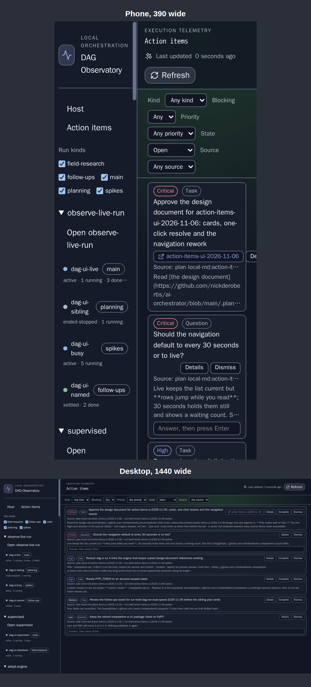

**After**

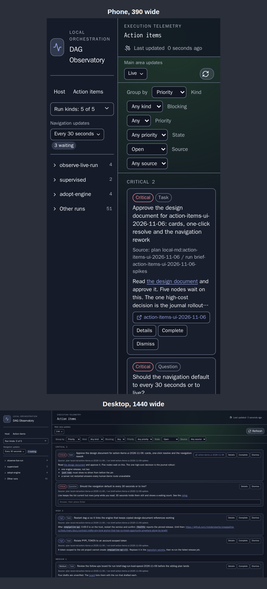

### The toast after Dismiss

Dismiss acts at once with no dialog. The card leaves and a toast offers Restore and Add reason. On a wide screen it sits at the bottom right; on a phone it stays across the bottom.

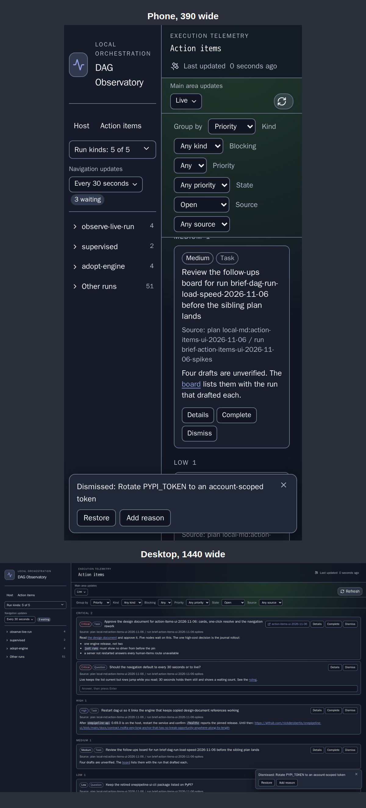

### The toast after Complete

Complete acts at once. The card leaves and a toast offers Reopen and Add comment. On a wide screen it sits at the bottom right; on a phone it stays across the bottom.

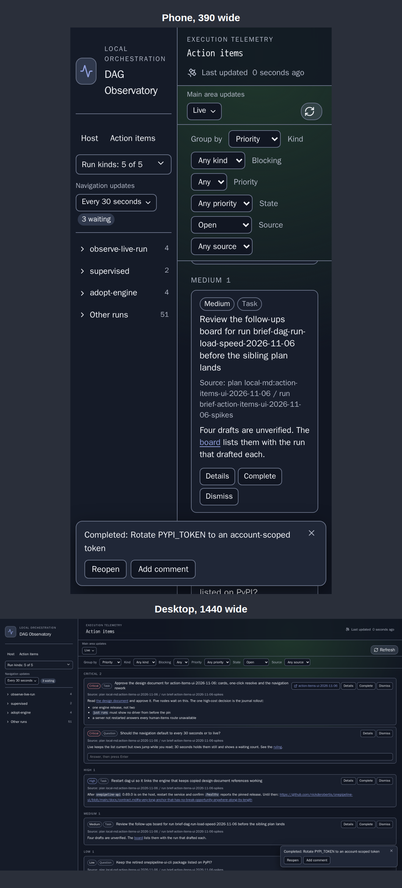

### Reopen greyed, with its reason open

Where an item cannot be reopened, Reopen is greyed with a small question mark on its text, as a superscript. Pressing the question mark opens the reason, which also works on a phone; on desktop hovering shows it too. Shown after completing an item whose script declares no undo.

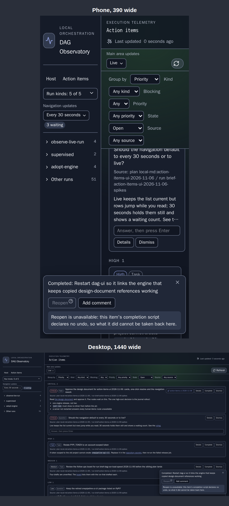

### A failed write

The card stays in its place with the reason on it, and the toast names what did not happen and why. On a phone the toast covers the bottom of the card, as the findings say; on a wide screen it sits at the bottom right, clear of this card. The refusal text is mock wording.

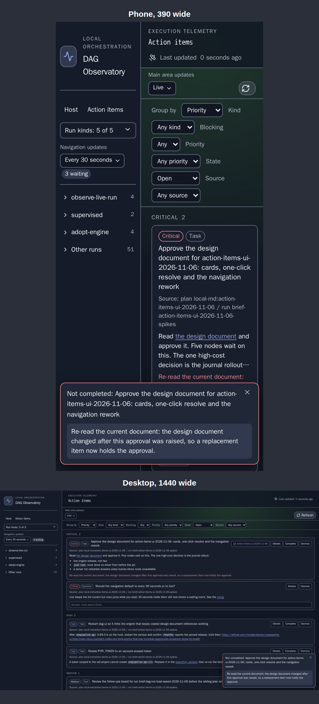

### Left navigation

Projects become compact rows with counts, collapsed except the selected run's project. Each run is a row of state dot, name and kind tag, and the Open links are gone. One Run kinds dropdown, shown open here, replaces the checkboxes. On a phone the tag takes a second line. The before is the deployed baseline, whose fixture has no run kinds, so it does not show the checkboxes being replaced; on a host with kinds they sit above the project list.

**Before**

**After**

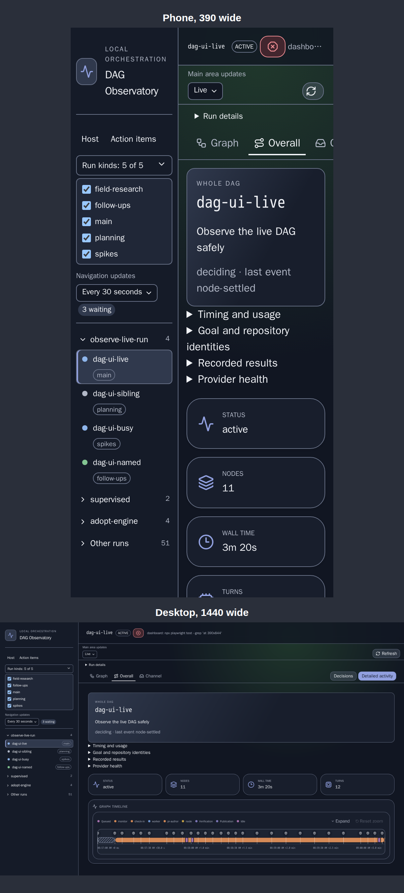

### Two update settings

The navigation and the main area each have one dropdown holding Live, Every 10 seconds, Every 30 seconds, Every minute, Every 5 minutes and Off, with a count of waiting changes beside it. Both are shown open so the picture shows what each holds; a real one closes when you look away. The navigation is at its default (every 30 seconds) and the main area is switched to Off to show its count; the main area defaults to Live, as the other shots show. Refresh sits beside the main area's setting, where a phone can reach it. The before is the deployed baseline, whose fixture has no kind tags.

**Before**

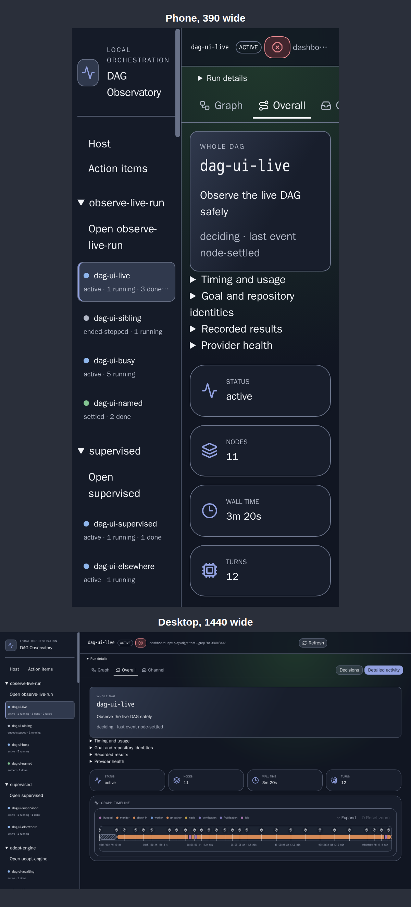

**After**

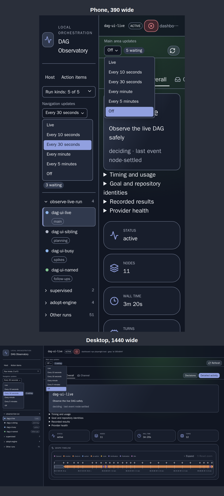

### A node's task as rendered markdown

The Task tab renders headings, lists, inline code and links instead of showing raw markdown in monospace, and a long URL wraps inside the panel.

**Before**

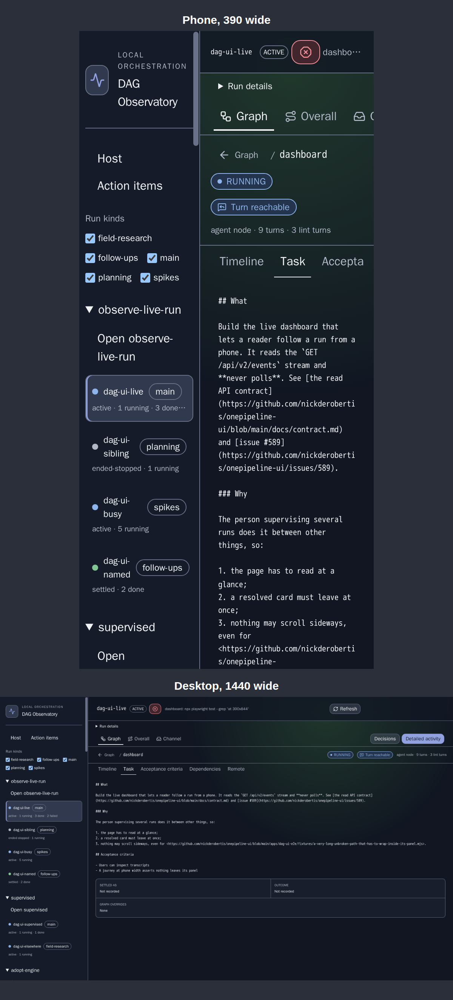

**After**

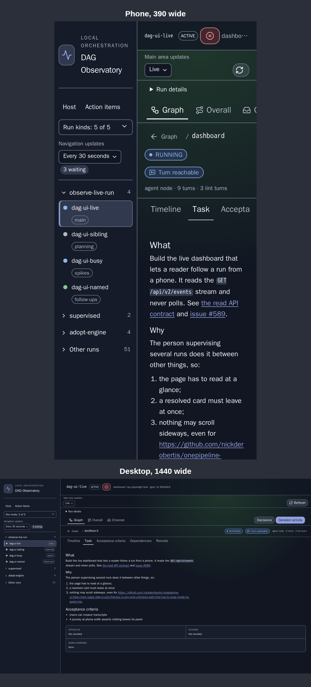

<!-- onetaskgraph:template-answers
branch: nick/action-items-ui-2026-11-06/spike-visual
candidates: []
findings:
- '**Phone width is the main problem, and the plan does not address it.** The shell keeps a 160 px navigation column at 390, leaving about 230 px for the main area. A card''s text gets about 175 px, so one long card fills most of the screen and Dismiss wraps onto its own line. Recommend making the navigation a drawer at phone width; this decides whether the cards and the navigation can meet their goals on a phone.'
- '**One line per run does not fit at phone width.** In the 160 px column a run''s name and kind tag do not fit on one line, so the mock puts the tag on a second line. The navigation task asks for one structured line. A drawer would resolve this; otherwise the tag has to drop at this width or the wording has to change.'
- '**The run''s counts have no home in the one-line row.** The mock moves `active · 1 running · 3 done` into a hover title, which a phone cannot reach. The navigation task does not say whether the counts survive, so the plan should decide; the state dot alone says much less.'
- '**The pinned controls leave little room for the list on a phone.** The title, update setting and five filters end about 345 px down, and with a toast showing only about 390 px of list remains (shots 2 to 4). The base already stacks the filters this way, and the update setting adds a row. Recommend folding the filters behind one disclosure at phone width, which no task states yet.'
- '**On a phone the toast can cover the card it is about.** In the failed write shot it hides the card''s own reason line and actions. The failure journey should bring the card into view above the toast, or the reason should appear in only one of the two places.'
- '**On a wide screen the toast can cover the actions of a card under it.** Anchored bottom right, it sits over the right end of the list, where a card''s Details, Complete and Dismiss are: in the Dismiss and Complete shots it hides the lowest visible card''s actions. Moving it does not remove the overlap, so the build should keep room below the list or accept it for the toast''s 15 seconds.'
- '**The update settings need a stated place.** The navigation task does not say where the controls go. The mock puts one in the navigation and adds a strip under the top bar for the other, which costs a row on every view: about 57 px on a phone, more when the waiting count wraps. The strip does solve an existing problem: at 390 the base run view has Refresh pushed off the top bar''s right edge, so it is not visible in the before. On desktop the strip could merge into the top bar.'
- '**The navigation''s waiting count takes its own line on a phone.** `Every 30 seconds` nearly fills the 160 px column, so the count wraps under the dropdown and adds a row to the navigation. A drawer or a shorter label such as `30s` would resolve it.'
- '**Phone touch targets are small.** In the mock the update dropdowns and card actions are 26 px tall. The greyed Reopen''s question mark is drawn at 11 px as asked, with an invisible hit area of about 33 px around it that overlaps the left edge of Add comment. The goals require usability on a phone, so the build should set a minimum size and a gap that keeps the two targets apart.'
- '**The six-card target in the page''s stylesheet does not hold under realistic content.** `styles.css` cites `docs/human-items.md` for six complete cards at 1440×900 with 80 to 160 character bodies. The mock shows four complete cards and part of a fifth, even with badges, title and actions on one row, because bodies with lists are taller. The target should be restated or the desktop clamp tightened.'
- '**The Priority badge repeats its group heading.** Under a heading reading Critical, every card also carries a Critical badge. Recommend omitting the badge for whichever field the list is grouped by.'
- '**Bold did not render in these captures.** `**text**` and headings show at regular weight even with an explicit `font-weight: 700`, so the mock separates headings by size alone. The cause was not investigated. It may be the capture''s font and not a phone or desktop browser, but the build should check it, because bold is part of rendered markdown.'
- '**`remark-gfm` is not in this repository''s `bun.lock`.** `react-markdown` alone gives no GFM, so bare URLs do not link and tables do not render; the mock''s long URLs had to use `<...>`. `TaskMarkdown` promises GFM, so `@onetaskgraph/ui` has to bring it.'
- '**A popup dropdown would be clipped in the navigation.** `.run-nav` sets `overflow: hidden`, and at phone width the column is 160 px. The mock opens the kind list and the navigation''s update list in flow, pushing the rows down; the build should either keep that or render the menu in a portal.'
- '**On a phone the card clamp can hide what matters.** Four lines of body cut off the bullet list on the first card, so its three rollout points are reachable only through Details. Desktop shows them. This may be acceptable, but it is a real loss for an approval read on a phone.'
harness: |
  `just spike-visual-screens` on that branch re-captures every picture, a few minutes once built, and needs Docker. It writes the shots to `shots/local/spike-visual/{before,after}` and the images this report names to `shots/local/spike-visual/report`. `scripts/spike-visual-capture.sh` is the driver and `apps/dag-ui-e2e/gallery.screens.spec.ts` holds the `SPIKE-before` and `SPIKE-after` surfaces.
method: |
  A throwaway mock inside the real `apps/dag-ui`, driven through the repository's capture path (`just dag-ui-screens`) in its pinned browser container. Each image stacks the phone shot (390 wide) over the desktop shot (1440 wide), because a report entry names one image.

  **What is mocked.** The Action items list is six invented items served by a browser-side stub, on both the base page and the mock. Complete and Dismiss write nothing: the card leaves locally and a toast appears, with no timer. The failed write is hard-coded to one item, and its refusal text is written to resemble the engine's. The waiting counts are hard-coded and nothing buffers events. Each update setting's dropdown is a disclosure rather than a native select, because a native select's open list cannot appear in a screenshot; the build can use either. Grouping, remembering a choice and animated reordering are not exercised. Markdown is `react-markdown` standing in for `@onetaskgraph/ui`.

  **The befores.** Changes 6 and 7 use the deployed gallery's baseline images, `11-project-list` and `01-run-list-overall`. Each run of the script requires the digests in the deployed `captures.json`, the digests in `shots/baseline/x86_64.json` and the downloaded image's own SHA-256 to agree at both widths, and they did for all of these. On a mismatch the script renders that before on the unchanged base, source and fixture both; that fallback was not needed here. On the base these two surfaces render the same picture, so changes 6 and 7 show the same before. Changes 1 and 8 have no gallery surface, so they were captured with `apps/dag-ui/src` restored from base commit 7acfdc8.

  **The fixture.** The mock's fixture gains kinds on six runs and a long markdown task on `dashboard`. The task appears in both pictures of change 8. The kinds appear only in the afters of changes 6 and 7, because the baseline's fixture has none.

  **Checks.** This spike owes none, and nothing here lands. No lint and none of the repository's test suites ran, and the mock's new surfaces are not expected to pass those tests. These did run: `npx tsc -p apps/dag-ui/tsconfig.json --noEmit` twice while building the mock's first commit, the first run reporting one error in `HumanItemsPage.tsx`, fixed, and the second none, and not again after the later commits; `just spike-visual-screens`, whose Playwright specs only take pictures: its run on 9a65520 exited 1 because `aria-disabled` on the greyed Reopen's wrapper also disabled the question mark inside it, which was fixed, and its last run, on the tree committed as d30edb7, exited 0; `playwright test --list`, showing the fallback's two surfaces resolve at both widths without running them; `cmp` of the images against the last capture's files: all four befores byte-identical to the images stored before that run, and the eight afters changed; and `onepipeline template check spike-report --item` on this report after each of its last three replacements, reporting ok.
spike: spike-visual
visual_changes:
- name: Action items cards, grouped by Priority
  description: Cards gain group headings with counts, rendered markdown with formatted links, and long titles, sources and URLs that wrap inside the card. On a phone the actions move to their own row; on desktop they stay on the title row. Group by joins the filters.
  before: b1-cards.png
  after: a1-cards.png
- name: The toast after Dismiss
  description: Dismiss acts at once with no dialog. The card leaves and a toast offers Restore and Add reason. On a wide screen it sits at the bottom right; on a phone it stays across the bottom.
  after: a2-dismiss-toast.png
- name: The toast after Complete
  description: Complete acts at once. The card leaves and a toast offers Reopen and Add comment. On a wide screen it sits at the bottom right; on a phone it stays across the bottom.
  after: a3-complete-toast.png
- name: Reopen greyed, with its reason open
  description: Where an item cannot be reopened, Reopen is greyed with a small question mark on its text, as a superscript. Pressing the question mark opens the reason, which also works on a phone; on desktop hovering shows it too. Shown after completing an item whose script declares no undo.
  after: a4-reopen-greyed.png
- name: A failed write
  description: The card stays in its place with the reason on it, and the toast names what did not happen and why. On a phone the toast covers the bottom of the card, as the findings say; on a wide screen it sits at the bottom right, clear of this card. The refusal text is mock wording.
  after: a5-failed-write.png
- name: Left navigation
  description: Projects become compact rows with counts, collapsed except the selected run's project. Each run is a row of state dot, name and kind tag, and the Open links are gone. One Run kinds dropdown, shown open here, replaces the checkboxes. On a phone the tag takes a second line. The before is the deployed baseline, whose fixture has no run kinds, so it does not show the checkboxes being replaced; on a host with kinds they sit above the project list.
  before: b6-nav.png
  after: a6-nav.png
- name: Two update settings
  description: The navigation and the main area each have one dropdown holding Live, Every 10 seconds, Every 30 seconds, Every minute, Every 5 minutes and Off, with a count of waiting changes beside it. Both are shown open so the picture shows what each holds; a real one closes when you look away. The navigation is at its default (every 30 seconds) and the main area is switched to Off to show its count; the main area defaults to Live, as the other shots show. Refresh sits beside the main area's setting, where a phone can reach it. The before is the deployed baseline, whose fixture has no kind tags.
  before: b7-updates.png
  after: a7-updates.png
- name: A node's task as rendered markdown
  description: The Task tab renders headings, lists, inline code and links instead of showing raw markdown in monospace, and a long URL wraps inside the panel.
  before: b8-task.png
  after: a8-task.png
-->
